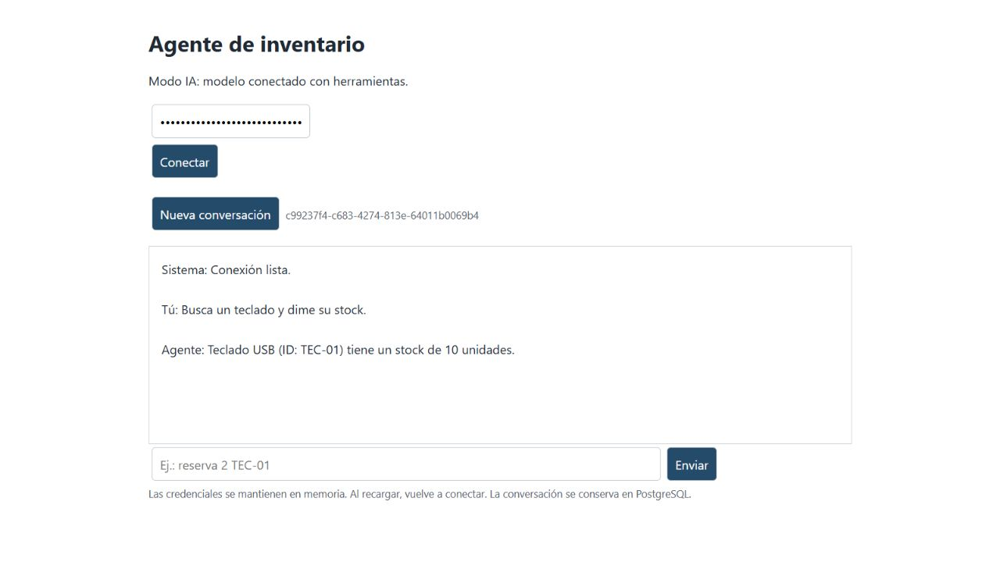
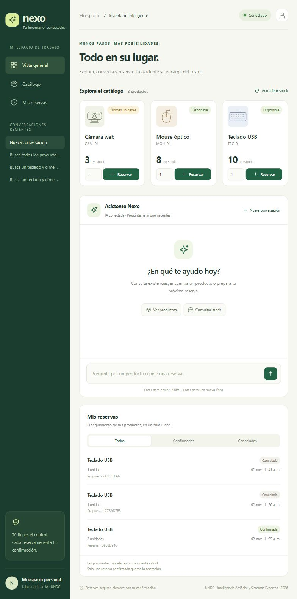

# Práctica 11: agente con LangGraph, MCP y Supabase

Universidad Nacional de Cañete · Ingeniería de Sistemas

Asignatura: Inteligencia Artificial y Sistemas Expertos

## Resultado

Nexo es una aplicación web con catálogo de productos, existencias, selección de
cantidades, chat con IA y un historial de operaciones. Permite proponer reservas
desde las tarjetas o mediante mensajes. La operación se registra únicamente
después de pulsar **Confirmar reserva**. **Cancelar** descarta la propuesta y
conserva el stock.

## Herramientas MCP utilizadas

El servidor MCP se encuentra en `app/mcp_server.py` y usa transporte `stdio`:
el backend inicia un proceso local y se comunica con él mediante entrada y salida
estándar. No requiere publicar otro puerto.

| Herramienta | Función |
| --- | --- |
| `buscar_producto` | Busca productos por nombre o código. |
| `consultar_stock` | Obtiene las existencias reales de un producto. |
| `registrar_reserva` | Registra una confirmación previamente aprobada y actualiza el stock. |
| `consultar_reserva` | Consulta una reserva de la cuenta autenticada. |

LangGraph organiza el flujo y lo pausa con `interrupt()` para solicitar la
aprobación. Al pulsar un botón de confirmación, el backend reanuda el grafo con
`Command(resume=...)`. El modelo puede **proponer** una reserva, pero no tiene
acceso directo a la herramienta de escritura `registrar_reserva`.

Supabase PostgreSQL conserva productos, conversaciones, confirmaciones,
reservas, auditoría y checkpoints. Una transacción verifica autorización y
existencias antes de descontar el stock. Repetir una confirmación devuelve la
reserva existente sin duplicar la operación. El historial se filtra por la
identidad autenticada.

## Evidencias

### Consulta real del stock



### Catálogo e historial de confirmaciones y cancelaciones

La captura muestra los productos con stock y el historial con una reserva
confirmada de dos teclados y propuestas canceladas.



La evidencia de la primera prueba está en [verificacion-local.json](verificacion-local.json).
El stock inicial del teclado era 12 y pasó a 10 al confirmar dos unidades.
Cancelar otra propuesta conservó el stock en 10; repetir la confirmación no
produjo un segundo descuento. Son resultados de esa ejecución, no datos fijos
que la interfaz simule.

## Validación

- Suite local: **11 pruebas aprobadas y 1 omitida**. La prueba omitida requiere
  configurar explícitamente una base de datos de pruebas.
- Comunicación MCP y consulta real a PostgreSQL verificadas con `check_mcp.py`
  y `check_db.py`.
- Flujo nuevo de botones verificado contra la aplicación y Supabase con un
  producto temporal: propuesta sin descuento, confirmación, reintento sin
  duplicación, cancelación y actualización del historial. Se retiraron únicamente
  los datos temporales de esa prueba.
- Se comprobó que los endpoints de catálogo, reservas y conversaciones requieren
  autenticación y que no se puede reservar en una conversación ajena.

Para ejecutar las pruebas locales:

```powershell
.\.venv\Scripts\python.exe -m pytest -q
```

## Ejecución

Sigue el [README](../README.md), completa tu propio `.env` y ejecuta:

```powershell
.\.venv\Scripts\python.exe run.py
```

Abre `http://127.0.0.1:8000` y conecta con tu token local. Las credenciales no
forman parte de esta entrega. El repositorio incluye `.env.example` como plantilla.
